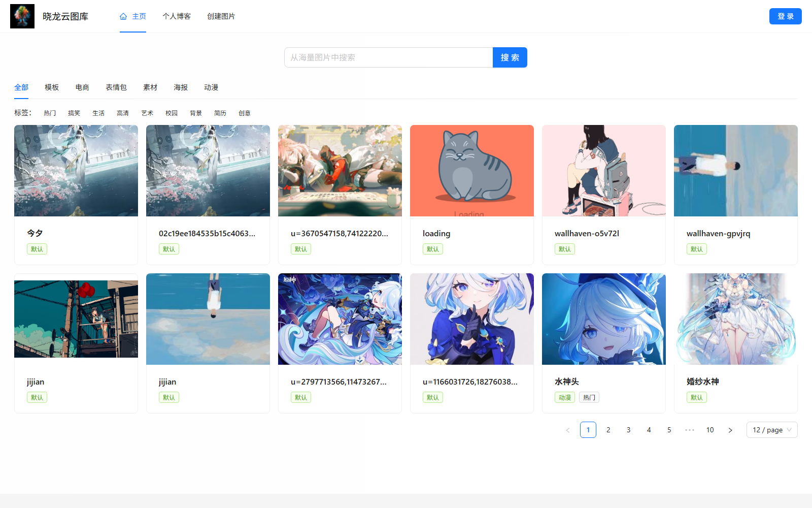
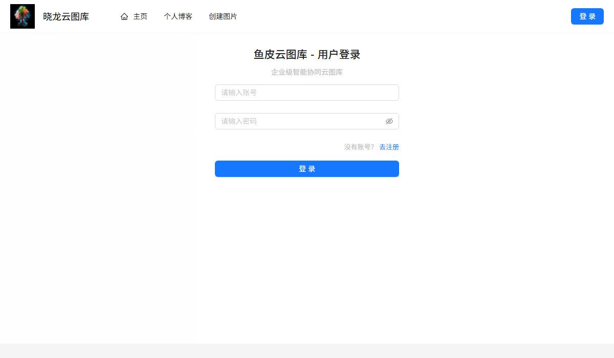
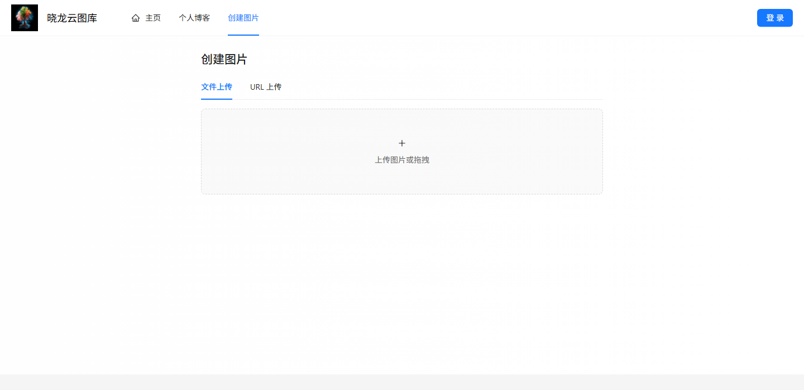
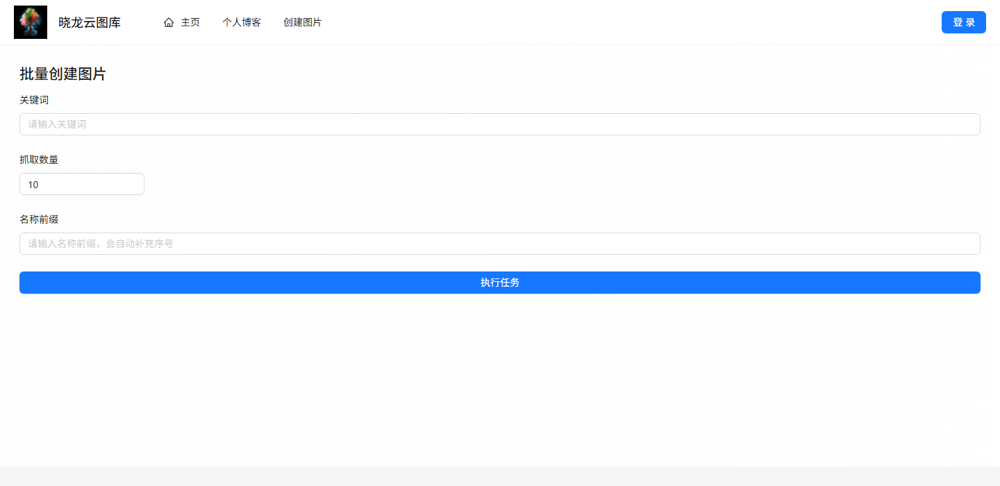

# ZXL-Picture 云图库

一个基于 **Spring Boot + Vue 3** 的前后端分离图片管理项目，支持公开图库浏览、图片上传与检索，并提供个人空间、团队空间和空间数据分析能力。

## 页面展示

### 公开图库

支持按分类、标签筛选图片，也可以输入关键词搜索。



### 登录与图片上传

| 用户登录 | 单张图片上传 |
| --- | --- |
|  |  |

单张上传页面支持本地文件和图片 URL 两种方式。

### 按关键词批量抓取

填写关键词、抓取数量和名称前缀后，可批量创建图片记录。



## 功能

- **图库浏览与搜索**：公开图库、分类和标签筛选、关键词搜索、以图搜图、按主色调查找相似图片。
- **图片录入与维护**：本地文件上传、URL 导入、图片裁剪、关键词批量抓取；支持编辑、删除和审核。
- **个人与团队空间**：创建私有空间或团队空间，管理空间成员及 viewer、editor、admin 角色。
- **空间分析**：查看空间用量、容量、分类、标签、成员和空间排行等统计。
- **协作与 AI**：团队空间通过 WebSocket 传递协作消息；接入阿里云 AI 扩图任务。
- **云存储**：图片文件使用腾讯云 COS 存储。

## 技术栈

| 部分 | 技术 |
| --- | --- |
| 前端 | Vue 3、TypeScript、Vite、Ant Design Vue、Pinia、Vue Router、Axios |
| 图表与图片处理 | ECharts、vue-echarts、vue-cropper |
| 后端 | Java 17、Spring Boot 2.7.6、MyBatis-Plus、Sa-Token |
| 数据与缓存 | MySQL、Redis、Spring Session、Caffeine、ShardingSphere |
| 文件与协作 | 腾讯云 COS、WebSocket、Disruptor |
| API 文档 | Knife4j |

## 项目结构

```text
.
├── zxl-picture-backend/       # Spring Boot 后端
│   ├── sql/create_user.sql    # 数据库建表脚本
│   └── src/main/java/         # controller、service、mapper、manager 等
├── zxl-picture-frontend/      # Vue 3 前端
│   └── src/                   # 页面、组件、API、路由与状态管理
├── docs/images/               # README 页面截图
└── README.md
```

## 本地运行

### 环境要求

- JDK 17、Maven
- Node.js、npm
- MySQL、Redis
- 腾讯云 COS 配置；阿里云 AI Key 用于扩图功能

### 1. 初始化数据库

在**新建的空数据库环境**中，使用有创建数据库和表权限的 MySQL 账号执行 `zxl-picture-backend/sql/create_user.sql`。脚本会创建 `zxl_picture` 数据库，以及应用的 `user`、`picture`、`space` 和 `space_user` 表；它不会创建 MySQL 登录账号。脚本包含 `ALTER TABLE` 语句，请勿在已初始化的数据库上重复执行。仓库不含图库演示数据，新库初始化后需要注册账号并上传图片，公开图库才会出现内容。

```bash
mysql -u YOUR_MYSQL_USER -p < zxl-picture-backend/sql/create_user.sql
```

### 2. 配置后端

项目默认启用 `local` 配置。创建 `zxl-picture-backend/src/main/resources/application-local.yml`，填入本地数据库、Redis、COS 和阿里云 AI 配置：

```yaml
spring:
  datasource:
    url: jdbc:mysql://127.0.0.1:3306/zxl_picture
    username: YOUR_MYSQL_USER
    password: YOUR_MYSQL_PASSWORD
  shardingsphere:
    datasource:
      zxl_picture:
        url: jdbc:mysql://127.0.0.1:3306/zxl_picture
        username: YOUR_MYSQL_USER
        password: YOUR_MYSQL_PASSWORD
  redis:
    host: 127.0.0.1
    port: 6379

cos:
  client:
    host: YOUR_COS_ENDPOINT
    secretId: YOUR_COS_SECRET_ID
    secretKey: YOUR_COS_SECRET_KEY
    region: YOUR_COS_REGION
    bucket: YOUR_COS_BUCKET

aliYunAi:
  apiKey: YOUR_ALIYUN_AI_API_KEY
```

请替换所有 `YOUR_...` 值，并勿将真实密钥提交到仓库。

COS 配置不能为空，否则后端创建 COS 客户端时会启动失败；阿里云 AI Key 需使用有效密钥才能调用扩图功能。

### 3. 启动后端

> **启动前注意：** 当前 `zxl-picture-backend/pom.xml` 将 Spring Boot Maven 插件的 `<skip>` 设为 `true`。请先改为 `false`，否则执行 `spring-boot:run` 会跳过应用启动。

```bash
cd zxl-picture-backend
mvn spring-boot:run
```

后端默认监听 `8123`，上下文路径为 `/api`。

### 4. 启动前端

```bash
cd zxl-picture-frontend
npm ci
npm run dev
```

Vite 默认地址为 `http://localhost:5173`。前端 API 地址当前配置在 `zxl-picture-frontend/src/request.ts`，默认为 `http://localhost:8123`。

### API 文档

后端启动后访问 [Knife4j 接口文档](http://localhost:8123/api/doc.html)。

## 其他项目

- [Zxl AI Agent](https://github.com/ZxlDragonDoctor/zxl-Ai-agent)
